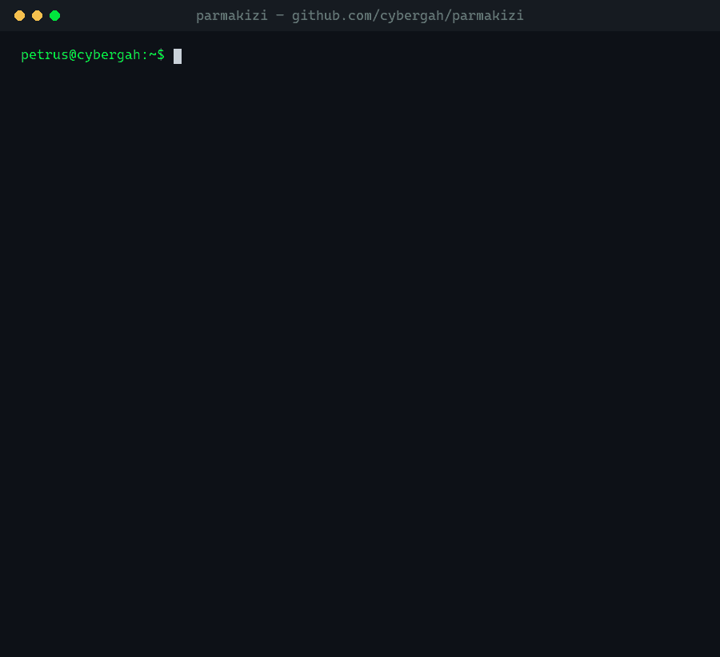

<div align="center">

# 🔎 Parmak İzi

**Find where a username exists across the public web.**

A fast, privacy-friendly OSINT command-line tool. *Parmak izi* means *fingerprint* in Turkish.

[](https://github.com/cybergah/parmakizi/actions/workflows/ci.yml)
[](https://github.com/cybergah/parmakizi/actions/workflows/site-health.yml)
[](https://pypi.org/project/parmakizi/)
[](https://github.com/cybergah/parmakizi/blob/main/pyproject.toml)
[](https://github.com/cybergah/parmakizi/blob/main/LICENSE)

[Web version](https://parmakizi.cybergah.com) · [Supported sites](#supported-sites) · [Add a site](https://github.com/cybergah/parmakizi/blob/main/CONTRIBUTING.md)

</div>

---

<p align="center">
  
</p>

## Why another username tool?

- **Verified rules only.** Every site rule ships with a known account and is
  re-checked against the live site every week by CI. Sites that hide behind
  bot challenges and give random answers are left out instead of producing
  false positives.
- **APIs first.** Wherever a site has a public JSON API, Parmak İzi asks the
  API instead of scraping HTML. That makes it faster and harder to break.
- **Honest results.** Besides *found* and *not found*, a result can be
  *unclear* or *error*, so you never mistake a blocked request for a missing
  account.
- **Privacy-friendly.** No accounts, no API keys, no telemetry. Route
  everything through Tor or any proxy with one flag.
- **One small dependency** (`httpx`), fully async, and it checks all sites in
  a few seconds.

## Install

```bash
pip install parmakizi
```

For SOCKS/Tor proxy support:

```bash
pip install "parmakizi[socks]"
```

Latest development version: `pip install git+https://github.com/cybergah/parmakizi`

Requires Python 3.10 or newer. Works on Linux, macOS and Windows.

## Usage

```bash
parmakizi alice                    # check one username
parmakizi alice bob carol          # several at once
parmakizi alice --tag dev          # only developer platforms
parmakizi alice -s GitHub -s GitLab
parmakizi alice --all              # also show where it was NOT found
parmakizi alice --json results.json --csv results.csv
parmakizi alice --json - | jq '.[] | select(.status=="found") | .url'
parmakizi alice --proxy socks5://127.0.0.1:9050   # through Tor
parmakizi --list-sites
parmakizi --self-test              # verify every rule against the live sites
```

| Symbol | Meaning |
|---|---|
| `[+]` | Account found |
| `[-]` | Not found (shown with `--all`) |
| `[~]` | Username is not valid on that site, so it was not checked |
| `[?]` | The site gave an unclear answer (for example rate limiting) |
| `[!]` | Network error or timeout |

### As a library

```python
import asyncio
from parmakizi.core import load_sites, search, Status

results = asyncio.run(search("alice", load_sites()))
print([r.url for r in results if r.status is Status.FOUND])
```

## Supported sites

32 platforms in the first release, every one verified with `--self-test`:

**Developer:** GitHub · GitLab · Codeberg · Bitbucket · Docker Hub · dev.to ·
Hashnode · Hacker News · Hugging Face · Kaggle · Codeforces · Trello  
**Security:** HackerOne · TryHackMe · Keybase  
**Social:** Telegram · Bluesky · Mastodon · Gravatar · About.me · Duolingo · Wikipedia  
**Media:** YouTube · Twitch · Vimeo · SoundCloud · Flickr · Dribbble · Instructables  
**Gaming:** Steam · Chess.com · Lichess

Run `parmakizi --list-sites` for the full list with URLs. Missing a site?
[Adding one](https://github.com/cybergah/parmakizi/blob/main/CONTRIBUTING.md) is a single line of JSON.

## Responsible use

Parmak İzi only looks at **public** profile pages and public APIs, the same
pages anyone can open in a browser. It does not log in, bypass protections or
collect private data.

Use it to audit your own digital footprint, for legitimate research and
journalism, and for investigations you are authorized to perform. Do not use it
to stalk, harass or dox anyone. You are responsible for complying with the laws
that apply to you and with each site's terms.

## Contributing

New site rules, bug reports and fixes are welcome. See
[CONTRIBUTING.md](https://github.com/cybergah/parmakizi/blob/main/CONTRIBUTING.md). To report a security issue, please follow
the [security policy](https://github.com/cybergah/.github/blob/main/SECURITY.md).

## License

[MIT](https://github.com/cybergah/parmakizi/blob/main/LICENSE) © Cybergah

<div align="center">
<sub>Part of <a href="https://github.com/cybergah">Cybergah</a>, offline-first, privacy-respecting open-source tools.</sub>
</div>
